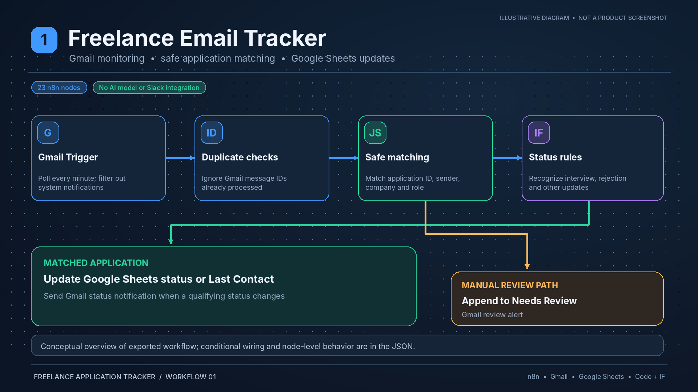
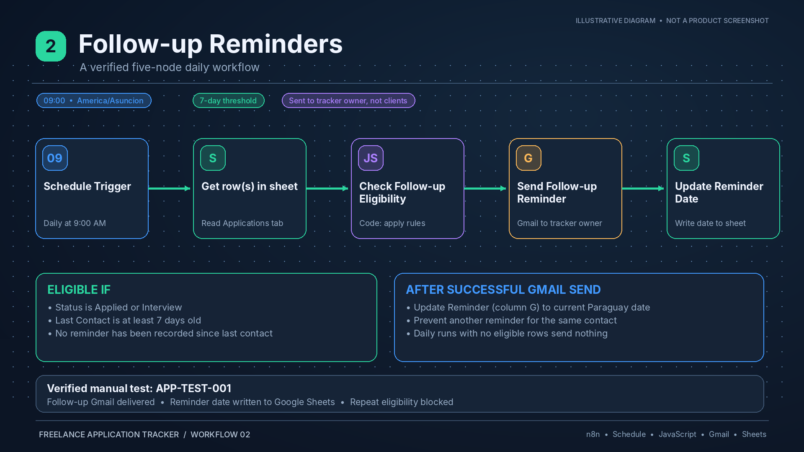
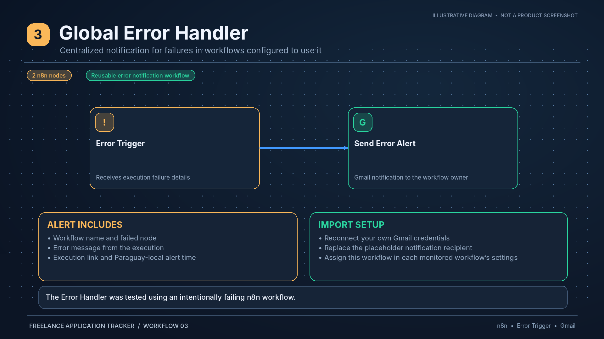
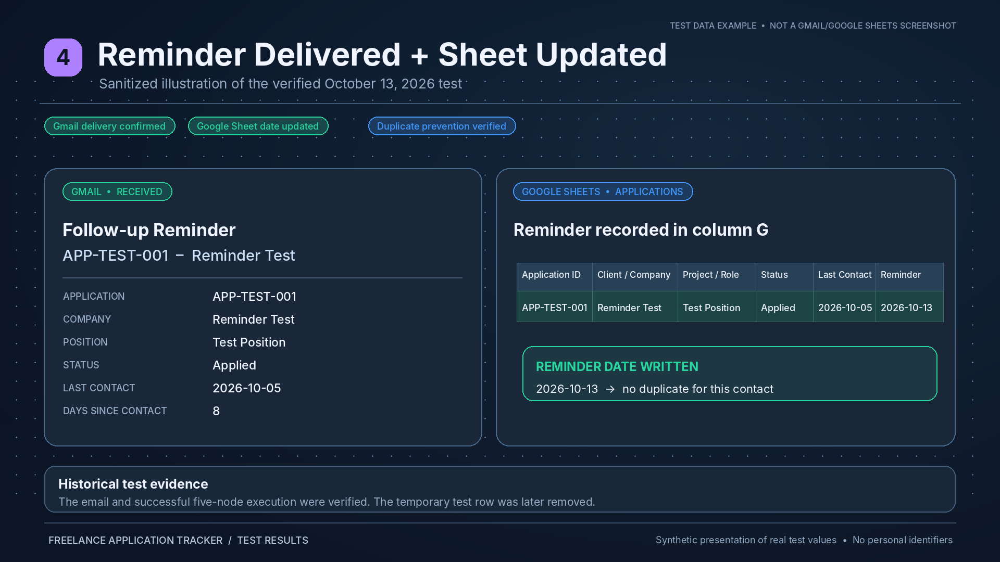
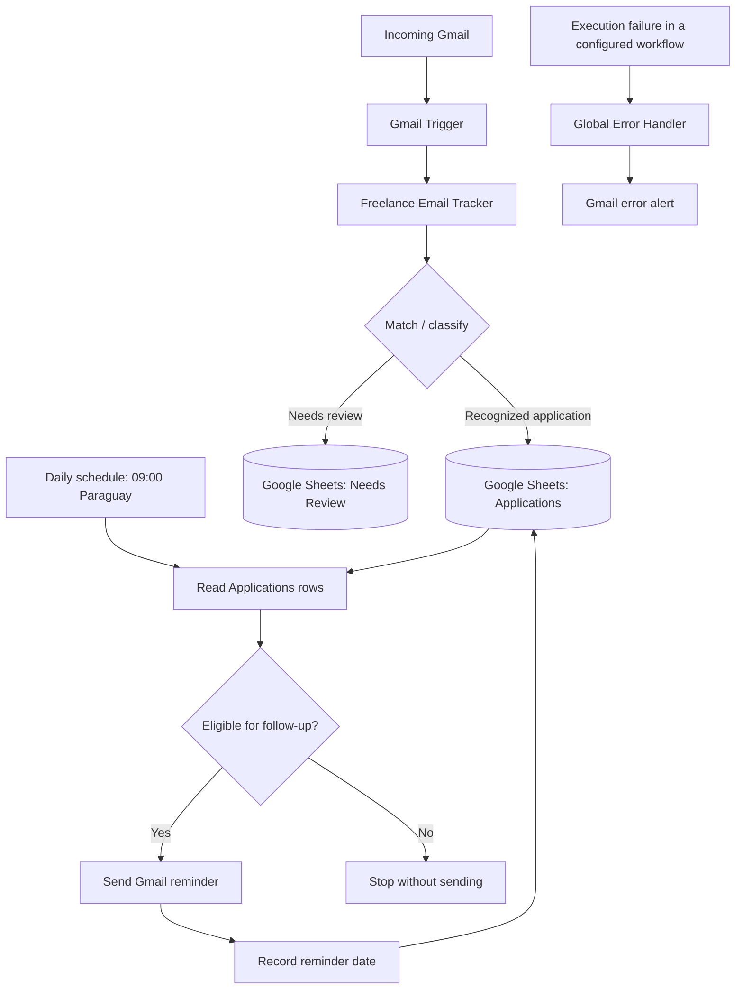

# Freelance Application Tracker — n8n Automation Portfolio

   

A practical, self-hosted **n8n workflow system** for tracking freelance applications, processing replies, sending follow-up reminders, and surfacing automation failures. Built as a portfolio demonstration of email automation, Google Sheets integration, JavaScript-based decision logic, and error handling.

> **Project status:** The primary email tracker and follow-up reminders workflows have been published. A follow-up reminder was delivered to Gmail, its reminder date was updated in Google Sheets, and a subsequent run correctly found no eligible duplicate reminder. The global error handler was separately tested and attached to the follow-up workflow. These tests validate the demonstrated paths, **not every possible incoming email or future scheduled run**.

## Portfolio visuals

The following are **illustrative portfolio diagrams**, not screenshots captured from a live n8n execution or Gmail session. They summarize the published automation architecture; the source-of-truth workflow definitions are the sanitized JSON files in [`workflows/`](workflows/). The example email and spreadsheet use demonstration data.

### Freelance Email Tracker



*Email intake, application matching, Google Sheets status updates, and manual-review routing. Simplified illustration; see the exported workflow for all nodes and branches.*

### Follow-up Reminders



*Daily 9:00 AM Paraguay check, 7-day follow-up eligibility, Gmail reminder to the tracker owner, and reminder-date write-back.*

### Global Error Handler



*Reusable n8n error trigger connected to Gmail notifications.*

### Reminder delivery and sheet update



*Sanitized visualization of the tested reminder-to-spreadsheet flow. For what was actually verified in n8n and Gmail, see [Test evidence](#test-evidence).*

## What it does

- **Tracks application-related emails:** A Gmail trigger polls for new messages and processes them against a Google Sheets-based application register.
- **Updates application records:** The tracker uses matching and classification steps to support updates to application status and contact history.
- **Keeps uncertain matches separate:** A `Needs Review` sheet is used for cases that require manual review.
- **Sends scheduled follow-up reminders:** Every day at **9:00 AM (`America/Asuncion`)**, the reminder workflow checks for applications in `Applied` or `Interview` status with no contact for at least **7 days**.
- **Avoids repeat reminders:** The workflow consults the `Reminder` column and suppresses reminders already recorded after the last contact.
- **Reports failures:** A reusable global error workflow sends Gmail notifications for workflows configured to invoke it.

## Architecture



The three n8n workflows in this project are:

| Workflow | Responsibility | Verified state |
| --- | --- | --- |
| **n8n Portfolio - Freelance Email Tracker DEMO** | Poll Gmail, classify/match messages, update or route spreadsheet records | Published; message-processing path tested |
| **n8n Portfolio - Freelance Follow-up Reminders** | Run a daily eligibility check, email reminders, update reminder dates | Published; complete five-node test passed |
| **n8n - Global Error Handler** | Receive error-trigger events and send Gmail alerts | Tested separately; selected as the follow-up workflow's Error Workflow |

> The existence of the global error handler does not mean every workflow is automatically protected. Assign it under each relevant workflow's **Settings → Error Workflow**.

## Tech stack

| Component | Role |
| --- | --- |
| **n8n (self-hosted)** | Workflow orchestration, triggers, integrations, executions |
| **Gmail / Gmail Trigger** | Incoming messages, outgoing reminders and error notifications |
| **Google Sheets** | Application and review records |
| **JavaScript Code node** | Eligibility calculation and date logic |
| **Docker + PostgreSQL** | Hosting and persistence of the n8n environment |
| **HTTPS reverse proxy** | Secure browser access to the hosted n8n editor |

Google Apps Script is **not required** for the demonstrated n8n workflows. A separate standalone Apps Script project was successfully tested for spreadsheet access, but it is not part of the production reminder path documented here.

## Data model

The Google spreadsheet has two tabs: **`Applications`** and **`Needs Review`**.

The `Applications` sheet uses these column headers **exactly**:

| Column | Header | Purpose | Example |
| --- | --- | --- | --- |
| A | `Application ID` | Unique application identifier used in lookups/updates | `APP-005` |
| B | `Client / Company` | Client or business name | `Example Studio` |
| C | `Project / Role` | Role or freelance project | `n8n Automation Developer` |
| D | `Contact Info` | Contact email or reference | `contact@example.com` |
| E | `Status` | Application stage | `Applied`, `Interview`, `Rejected` |
| F | `Last Contact` | Last known contact date | `2026-10-05` |
| G | `Reminder` | Date the latest reminder was recorded | `2026-10-13` |

**Date format:** `YYYY-MM-DD` (ISO date). Keep dates consistent, particularly in `Last Contact` and `Reminder`. Other statuses may exist, but the follow-up workflow currently acts **only** on `Applied` and `Interview`.

`Needs Review` is a separate review destination for items the tracker cannot confidently process. The exact fields and review criteria depend on the exported workflow configuration.

## Workflow details

### 1. Freelance Email Tracker

**Trigger:** Gmail Trigger, configured to poll approximately once per minute in the demonstrated setup.

**High-level flow:**

1. Read a newly detected Gmail message.
2. Extract relevant email data.
3. Determine whether it matches an existing application and assess the message's meaning.
4. Update a matching application in the `Applications` sheet, or route uncertain cases to `Needs Review`.
5. Apply duplicate-protection and branch-specific actions according to the workflow's configured logic.

**Loop protection:** The Gmail Trigger's Search field excludes messages whose subjects match the automation's own notification prefixes:

```text
-subject:"Freelance Tracker" -subject:"n8n ERROR" -subject:"Follow-up Reminder"
```

This is a subject-based safeguard for the documented notification subjects; it does not guarantee protection from every possible message loop. Preserve the filter if you rename notification subjects, and test any additional self-generated mail types.

### 2. Follow-up Reminders

**Schedule:** Every **1 day**, at **9:00 AM**, minute **0**, in `America/Asuncion`.

**Verified node sequence:**

```text
Schedule Trigger
    ↓
Get Row(s) in Sheet
    ↓
Check Follow-up Eligibility (Code)
    ↓
Send Follow-up Reminder (Gmail)
    ↓
Update Reminder Date (Google Sheets)
```

An application qualifies only when:

1. `Status` is `Applied` or `Interview` (case-insensitive after trimming).
2. `Last Contact` is a valid `YYYY-MM-DD` date.
3. At least **7 calendar days** have passed since `Last Contact`, using the Paraguay date.
4. `Reminder` is blank **or** contains a valid date **earlier** than `Last Contact`.

If `Reminder` already contains a date equal to or later than `Last Contact`, the application is skipped. Invalid non-empty reminder values are conservatively skipped rather than risking repeated sends. The current policy therefore sends **at most one recorded reminder per contact cycle**; it is not a weekly repeating reminder system.

The Code node uses `America/Asuncion` via `Intl.DateTimeFormat`, validates ISO dates, calculates elapsed whole days, and returns **one output item per eligible application**. When no applications qualify, the Code node returns no items, and Gmail and the Sheets update node do not run. This is expected behavior—not a failed execution.

The test email subject was structured as:

```text
Follow-up Reminder - APP-TEST-001 - Reminder Test
```

The final Sheets node matches the record by `Application ID` and writes the computed reminder date to column G.

**Reliability note:** Sending an email and updating Sheets are two separate operations, not an atomic transaction. If Gmail succeeds but the Sheets write fails, a later run might send another reminder. Production hardening could introduce idempotency keys, a sent-message log, or an explicit retry/reconciliation process.

### 3. Global Error Handler

A separate workflow, **`n8n - Global Error Handler`**, uses n8n's Error Trigger and a Gmail notification step. It was tested using an intentionally failing test workflow. The Follow-up Reminders workflow was subsequently configured to use it under **Settings → Error Workflow**.

For comprehensive coverage, inspect and set the Error Workflow on the primary Email Tracker as well; that additional attachment is **not confirmed by the available test evidence**. An intentionally failing test workflow should be disabled when testing is complete, particularly if it exposes a public webhook.

## Setup guide

The three sanitized n8n workflow JSON exports are included in the [`workflows/`](workflows/) folder. To reproduce this project, you will need your own Google credentials and a Google spreadsheet with the required headers. These templates are inactive and their account-specific resource selectors have been cleared.

1. **Prepare n8n.** Run a recent n8n release, preferably on HTTPS with a durable backing database. Set the instance/workflow timezone to `America/Asuncion`.
2. **Prepare Google Sheets.** Create the `Applications` and `Needs Review` tabs. Add the seven headers listed in the data model section.
3. **Configure Google credentials.** Connect Google Sheets and Gmail in n8n using your own authorized Google account and OAuth configuration.
4. **Import the workflows.** Import the three JSON files from the `workflows/` folder, reconnect credentials, set the notification recipient, and select your spreadsheet and sheet names on every Google Sheets node. Reassign the Global Error Handler in workflow settings, since internal workflow IDs are stripped. Do not assume resource IDs will match another environment.
5. **Configure the Gmail exclusions.** Enter the three `-subject:` clauses in the incoming Gmail Trigger's Search field.
6. **Configure reminders.** Set the daily 9:00 AM trigger, use the seven-day eligibility logic, and map `Application ID` and `Reminder` correctly in the Google Sheets update node.
7. **Connect error handling.** Assign `n8n - Global Error Handler` in each intended workflow's Error Workflow settings.
8. **Run a controlled test.** Use a distinct test application, check that only the expected record is eligible, verify email delivery, then confirm the reminder date update.
9. **Publish enabled workflows.** Verify there are no unpublished changes and check n8n's **Executions** history after the first scheduled run.

### Example test record

```csv
Application ID,Client / Company,Project / Role,Contact Info,Status,Last Contact,Reminder
APP-TEST-001,Reminder Test,Test Position,test@example.com,Applied,2026-10-05,
```

This is **historical test data**, not a date guaranteed to qualify on the day you reproduce the project. Choose an appropriate date at least seven days before the current Paraguay date, and send test messages only to an address you control.

## Test evidence

The following results were observed during the project's guided tests:

| Test | Observed result |
| --- | --- |
| Eligible row (`APP-TEST-001`) | Code node returned one matching item (8 days since contact during the test) |
| Gmail reminder delivery | Email appeared in Gmail with subject `Follow-up Reminder - APP-TEST-001 - Reminder Test` |
| Google Sheets reminder update | Column G recorded `2026-10-13` for the test record |
| Repeat eligibility check | No output for the already-reminded test application |
| End-to-end execution review | All five reminder nodes displayed successful execution |
| Gmail self-mail exclusion | Search exclusions configured for tracker, error and follow-up messages |
| Error handler | Separate deliberate-error test previously completed |

**Evidence scope:** These observations validate the demonstrated test path. Scheduled delivery at every future 9:00 AM run, every category of incoming email, failure/retry semantics, and every workflow's error-handler attachment have not all been independently verified.

### Additional evidence screenshots (future enhancement)

Four **illustrative** portfolio graphics are already in `docs/screenshots/` and displayed above. For stronger independently verifiable evidence, add genuine screen captures from the n8n editor and execution history, plus redacted Gmail and Google Sheets test results. Remove or blur any email addresses, OAuth IDs, live URLs, tokens, private messages, and client information before uploading. Clearly label live captures as screenshots and illustrations as diagrams.

## Security and privacy

- **Never commit** OAuth client secrets, access/refresh tokens, n8n credential exports, `.env` files, production email messages, or private applicant/client details.
- Export workflows **without credentials** and inspect JSON for embedded identifiers or personal data before publishing.
- Publish only synthetic spreadsheet rows and sanitized screenshots.
- Protect the n8n editor with HTTPS, access controls, and regular software updates.
- Restrict who can access the spreadsheet and Gmail account; grant only the permissions required for the integration.
- Review any test webhooks and disable those not meant for production.

## Operational notes and limitations

- **No eligible applications:** A successful scheduled run may finish after the Code node with no Gmail or Sheets update activity.
- **Date formatting:** Non-ISO or invalid dates do not qualify for a follow-up.
- **Status restrictions:** Only `Applied` and `Interview` are eligible under the current logic.
- **Email classification:** Match accuracy depends on the actual tracking workflow's rules and incoming email formats; uncertain cases belong in `Needs Review`.
- **Duplicate protection:** The `Reminder` date helps avoid duplicates after a successful write but cannot alone guarantee exactly-once email delivery across partial failures.
- **Execution monitoring:** Review n8n execution history and Gmail alert delivery periodically, especially after credential changes or upgrades.
- **Time zone:** Both the schedule and the eligibility date calculation should remain aligned to `America/Asuncion`.

## Potential improvements

- Add a sent-reminder log with idempotency handling and retries.
- Build an application dashboard showing statuses, follow-up age, and response rates.
- Add manual approval for uncertain classification results.
- Add configurable follow-up thresholds and per-client preferences.
- Export and version all three workflows, with sanitized fixtures and repeatable test cases.
- Add operational alerts for missed scheduled executions as well as hard failures.

## Repository layout

The following files are published:

```text
n8n-freelance-application-tracker/
├── README.md
├── workflows/
│   ├── email-tracker.json
│   ├── follow-up-reminders-sanitized.json
│   └── global-error-handler.json
└── docs/
    └── screenshots/
        ├── 01-email-tracker-corrected.png
        ├── 02-follow-up-reminders-corrected.png
        ├── 03-global-error-handler-corrected.png
        └── 04-reminder-results-corrected.png
```

A potential future addition is synthetic sample data under `examples/`, along with genuine redacted screenshots of execution evidence.

## Portfolio summary

**Problem:** Freelancers can lose track of applications, miss replies, or forget to follow up.

**Solution:** A self-hosted n8n system that connects Gmail and Google Sheets to track application communication, classify messages, identify overdue follow-ups, and notify the user while logging reminder activity.

**Demonstrated skills:** n8n workflow design, Gmail and Google Sheets OAuth integrations, data matching, JavaScript date logic, error handling, safe testing, HTTPS self-hosting, and workflow observability.

---

*Built as an automation portfolio demonstration. Workflow exports are sanitized templates; reconnect your own accounts and review the data before using them.*